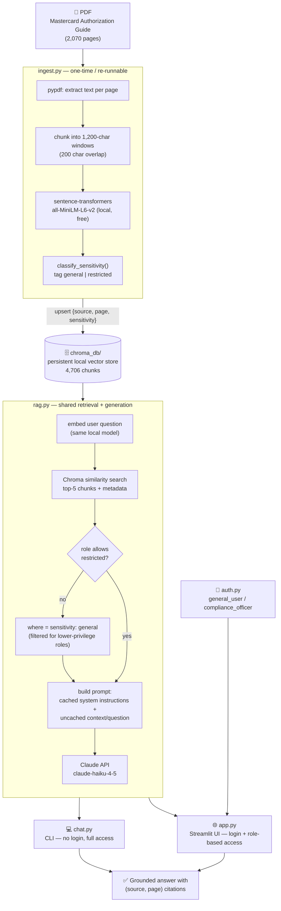

# Mastercard Spec Advisor

A Retrieval-Augmented Generation (RAG) chatbot that answers questions about
card network rules, grounded in the **Mastercard Authorization System Guide**
(a 2,070-page reference PDF). Available both as a polished web UI (with
login and role-based content restriction) and a CLI. Built as a small,
self-contained demo of a production-style RAG pattern: local/free retrieval
+ paid generation only where it adds value, plus a realistic access-control
layer.

> **Disclaimer:** This is an independent demo project, not affiliated with,
> endorsed by, or sponsored by Mastercard. "Mastercard" references are to
> the public specification document used as the knowledge base.

## Why this architecture

The goal was to build something real and defensible, not a toy, while
keeping cost at (near) zero during development:

| Stage | Choice | Why |
|---|---|---|
| Embeddings | `sentence-transformers` (`all-MiniLM-L6-v2`), run locally | Free, no API key, no per-token cost, fast enough for a 4,700-chunk corpus |
| Vector store | `chromadb`, persisted to disk | Free, zero-ops, no server to run — a single `PersistentClient` directory |
| Chunking | Fixed-size (1,200 chars, 200 overlap), per-PDF-page | Simple, predictable, and preserves page numbers for citations — no need for a more complex semantic chunker at this scale |
| Generation | Claude API, `claude-haiku-4-5` | Only the final answer-generation step costs money; Haiku keeps per-query cost low while still producing grounded, well-cited answers |
| Prompt caching | `cache_control: ephemeral` on the system prompt | The system prompt (instructions, role) is static across every query — caching it cuts cost/latency on repeated calls. The retrieved context and question change every time, so they're deliberately left uncached |
| Citations | Chroma metadata (`source`, `page`) attached per chunk at ingest time | Lets the model cite `(source, page X)` instead of answering from parametric memory, and lets a user verify any claim against the source PDF |
| Access control | Keyword-based `sensitivity` tag (`general`/`restricted`) per chunk, enforced via a Chroma `where` filter at query time | Demonstrates RBAC-aware retrieval without needing a second document — security-sensitive sections (PIN handling, key management, data-compromise procedures) are filtered out before they ever reach the LLM prompt for lower-privilege roles |

This mirrors a real-world cost-conscious RAG design: free/local wherever
retrieval and storage are concerned, paid API only at the point where it's
actually earning its cost (natural-language generation) — with access
control enforced at the retrieval layer, not left to the LLM to self-censor.

## Architecture



> Rendered automatically by GitHub on this page. If you're viewing this
> elsewhere and it shows as a code block instead of a diagram, open this
> file on github.com/vs-101/card-network-rag or in any Mermaid-compatible
> markdown viewer.

## Project structure

```
card-network-rag/
├── rag.py               # Shared: embeddings, Chroma access, sensitivity classifier, retrieval, generation
├── ingest.py             # PDF → chunk → embed → Chroma, tags sensitivity at ingest time
├── tag_sensitivity.py    # One-off migration: backfill sensitivity tags on already-ingested chunks
├── auth.py               # Demo login (2 roles): general_user, compliance_officer
├── app.py                # Streamlit web UI: login + role-filtered chat, custom styling
├── chat.py               # CLI chatbot (full access, no login)
├── evals/
│   ├── testset.jsonl     # 20 labeled test questions (general/restricted/out_of_scope)
│   ├── run_evals.py      # Eval runner: RBAC leakage, faithfulness, abstention checks
│   └── report.md         # Generated after each run; committed so the latest results are visible on GitHub
├── .streamlit/config.toml # Theme (colors, font)
├── requirements.txt      # Pinned dependencies
├── .env                  # ANTHROPIC_API_KEY (gitignored, never commit)
├── .env.example          # Template for the above
├── .gitignore
├── chroma_db/             # Persistent vector store (gitignored)
├── data/                  # (unused placeholder for future source docs)
└── venv/                  # Python virtual environment (gitignored)
```

## Setup

```bash
cd card-network-rag
python3 -m venv venv
source venv/bin/activate
pip install -r requirements.txt
```

Add your Anthropic API key:

```bash
cp .env.example .env
# then edit .env and replace the placeholder with your real key
# get a key at https://console.anthropic.com -> Settings -> API Keys
```

> **Note:** keys must be a Console API key (prefix `sk-ant-api03-...`).
> Never commit `.env` — it's already in `.gitignore`.

## Ingesting documents

```bash
source venv/bin/activate
python ingest.py "/path/to/your.pdf"          # single file
python ingest.py "/path/to/directory/"        # all PDFs in a directory
```

This is idempotent — chunk IDs are deterministic (`{filename}_p{page}_c{chunk}`),
so re-running `ingest.py` on the same file upserts rather than duplicates.
Each chunk is automatically tagged `sensitivity: general|restricted` based on
keyword classification (see `RESTRICTED_KEYWORDS` in `rag.py`).

Currently ingested: `m_DMAS_en-us-2026-08-25.pdf` (Mastercard Authorization
System Guide), 2,070 pages → 4,706 chunks (380 tagged `restricted`, 4,326
tagged `general`).

If you have an existing collection that predates the sensitivity feature,
backfill it without re-embedding:

```bash
python tag_sensitivity.py
```

## Running the web UI (recommended — login + role-based access demo)

```bash
source venv/bin/activate
streamlit run app.py
```

Opens at `http://localhost:8501` with a custom theme (`.streamlit/config.toml`)
and styling (card-style login, role badges, branded header) — see `app.py`'s
`CUSTOM_CSS` block to tweak colors/fonts. Two demo accounts are seeded in
`auth.py`:

| Role | Username | Password | Access |
|---|---|---|---|
| General User | `analyst` | `analyst123` | `general` content only |
| Compliance Officer | `compliance` | `compliance123` | `general` + `restricted` (security-sensitive) content |

Try asking **"How is a PIN verified during an authorization request?"** as
each user:
- As `analyst`, you get an answer plus a notice that N additional relevant
  sections exist in restricted content, hidden at your access level.
- As `compliance`, you get the full answer, including the PIN/key-management
  material the general user couldn't see.

This demonstrates enforcement at the **retrieval layer** — restricted chunks
are filtered out via a Chroma `where` clause before they're ever included in
the prompt sent to Claude, not just asked to be "ignored" by the model.

> Demo auth only: credentials are hardcoded with unsalted SHA-256 hashing in
> `auth.py` for simplicity. Swap for a real identity provider (OAuth/SSO) and
> salted hashes (bcrypt/argon2) before using this pattern anywhere real.

## Running the CLI (no login, full access)

```bash
source venv/bin/activate
python chat.py
```

```
Ready. Knowledge base: 4706 chunks from the Mastercard Authorization guide.
Ask a question (or type 'exit' to quit).

You: What is an authorization request?

Assistant: Based on the provided context, I can offer a limited answer:

An authorization request is a message used in card transactions.
Specifically, the context mentions the "Authorization Request/0100 message"
as an acquirer-generated message used in the Mastercard Dual Message
Authorization System (source, page 1795).
...
```

Note the model also correctly declines to over-answer when the retrieved
context is thin — e.g. asked "What is a chargeback?" (a topic the
Authorization guide only mentions in passing), it says so explicitly rather
than inventing an answer. That's the RAG grounding working as intended.

## AI evals

Beyond manual spot-checking, the project includes an automated eval suite
(`evals/`) that runs a labeled test set against the live pipeline and scores
the results. Three checks, ordered from most to least rigorous:

1. **RBAC leakage (deterministic, hard pass/fail)** — for every `restricted`
   test question, a `general_user` retrieval must *never* return a chunk
   tagged `sensitivity: restricted`, while a `compliance_officer` retrieval
   should. This is a security invariant, not a quality judgment: a failure
   here means the access-control filter itself is broken. The script exits
   non-zero on any leak, so it's CI-gateable.
2. **Faithfulness (LLM-as-judge, 1–5)** — for every question, Claude grades
   whether the generated answer is actually supported by the retrieved
   context, catching hallucination beyond what was retrieved.
3. **Abstention (LLM-as-judge, pass/fail)** — for `out_of_scope` questions
   (things the knowledge base doesn't cover, e.g. "What is the weather
   forecast for tomorrow?"), checks that the assistant said so rather than
   fabricating a confident-sounding answer.

The test set (`evals/testset.jsonl`) has 20 labeled questions: 10 `general`,
5 `restricted` (PIN handling, CVC2, key management, data compromise, track 2
data), and 5 `out_of_scope` (chargebacks, dispute timelines, Visa-specific
rules, interchange fees, and an unrelated question entirely).

Run it with:

```bash
source venv/bin/activate
python evals/run_evals.py
```

This prints progress per question, writes `evals/report.md`, and exits `1`
if RBAC leakage is ever detected. Latest run: **0 RBAC leakage failures**,
**4.80/5 average faithfulness**, **5/5 correct abstentions** on out-of-scope
questions — see `evals/report.md` for the full per-question breakdown.

> **Note on the judge model:** the eval script reuses `claude-haiku-4-5`
> (the same model used for generation) as the LLM judge, to keep this demo
> at near-zero cost. In a production eval setup you'd typically use a
> stronger or structurally different model as judge than the one being
> evaluated, to avoid the generator and judge sharing the same blind spots.

## Design notes / talking points

- **Grounded, not memorized**: the system prompt instructs Claude to answer
  only from retrieved context and to say when it doesn't know — this avoids
  hallucinated card-network rules, which matters a lot in a compliance-
  adjacent domain.
- **Citations by construction**: page numbers are captured once, at ingest
  time, as metadata — not inferred by the LLM — so citations are always
  accurate to the source document.
- **Access control enforced before generation, not after**: restricted
  chunks are excluded from the Chroma query results for lower-privilege
  roles — the LLM never sees them, so there's no reliance on the model
  "choosing" not to leak sensitive content.
- **Transparent restriction**: the UI tells a general user when relevant
  but restricted content was withheld (count only, not content) — a useful
  pattern for demonstrating RBAC without silently failing or confusing users.
- **RBAC is tested, not just implemented**: the eval suite's leakage check
  re-verifies the access-control invariant on every run against the live
  vector store, rather than trusting that the `where` filter in `rag.py`
  stays correct as the code evolves.
- **Cost control**: embeddings and vector search are fully local/free; the
  only metered cost is the final Haiku completion per query, with prompt
  caching reducing that further on repeated system-prompt reuse.
- **Scaling path**: swapping `chromadb` for a hosted vector DB (e.g.
  Pinecone/Weaviate) or moving the embedding step to an API-based model are
  both drop-in replacements — the retrieval/generation contract (`query()` →
  chunks → prompt) doesn't change. Same for swapping the keyword-based
  sensitivity classifier for a proper per-document ACL or a classifier model.

## Future improvements

- Multi-document ingestion (dispute rules, Visa/Amex guides, etc.) to make
  this a true cross-network knowledge base.
- Re-ranking retrieved chunks before generation for higher precision.
- Conversation memory across turns (currently each question is independent).
- Real identity provider (OAuth/SSO) instead of the hardcoded demo accounts.
- More granular roles (e.g. per-data-element access) instead of a binary
  general/restricted split.
- Expand `evals/testset.jsonl` with retrieval-quality metrics (precision/
  recall/MRR against a labeled relevant-chunk set) and a stronger/different
  judge model than the generator.
- Wire `evals/run_evals.py` into CI so the RBAC leakage check gates merges.
